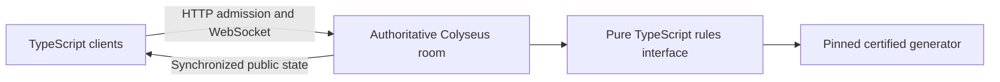

# Use TypeScript, Node and Colyseus

Status: **Accepted**. Decision date: **29 October 2026 (Asia/Singapore)**.

## Context and decision
The owner explicitly chose “go with typescript and colyseus” after discussing delivery speed and modern-Java learning. Use TypeScript for browser and server code, Node for the backend runtime, and Colyseus for authoritative private rooms and state transport. This settles [issue 2](https://github.com/matthew-ngzc/fruit-box/issues/2); hosting remains [issue 4](https://github.com/matthew-ngzc/fruit-box/issues/4).

## Boundaries and consequences
Pure board generation, inspection and clearing live in [the rules module](../../src/rules.ts), independent of connections, framework state and clocks. [The room](../../src/game-room.ts) owns synchronized state, guest admission and, in later slices, serialized authoritative commands and deadlines. Keep board generation and solver work out of live move processing. This first slice generates once during room creation; generation is synchronous and may briefly block other rooms during setup, so precomputation or workers are required before a load/latency claim.

TypeScript enables shared rules and protocol types. Network data still needs runtime validation. Colyseus supplies room seats, transport and synchronization; match ordering, pause budgets, duplicate delivery and reconnect policy still require game logic and tests. This selects neither Colyseus managed hosting nor a public deployment.

Java/Spring was a viable learning-oriented alternative but would need a separate authoritative rules implementation and more room infrastructure. Python and Rust remain possible later research tools; they are not runtime dependencies of the first release.

## Flow

Media folder: [adr-0003](../assets/adr-0003/). Actual room setup and limitations: [versus rooms](../versus-rooms.md). The historical [technology comparison](../research/technology-options.md) preserves the alternatives.
