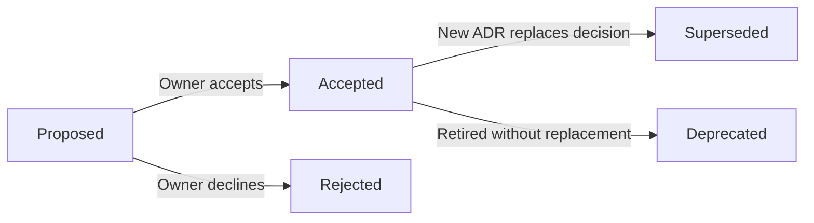

# Architecture decision records

ADRs preserve consequential choices and their reasoning so future agents do not silently reverse them or reconstruct them from PR history. They complement implementation issues and PR explanations; they are not task plans or a record of every small edit.

## Folder layout

The `adr/` and `assets/` folders are siblings under `docs/`. Each ADR has a media folder named by its stable identifier:

```text
docs/
├── adr/
│   ├── README.md
│   └── 0001-order-contested-clears-at-the-room-server.md
└── assets/
    ├── README.md
    └── adr-0001/
        └── .gitkeep
```

Store an ADR's pictures, exported diagrams, and recordings in `../assets/adr-NNNN/`, and reference them relatively from the record. Create the matching folder with each ADR; use `.gitkeep` while it has no media so a clone preserves the layout. Keep folder identifiers stable when titles change. See [the media convention](../assets/README.md).

## Register

| ID | Decision | Status | Decision date | Media | Context / delivery |
| --- | --- | --- | --- | --- | --- |
| 0001 | [Order contested clears at the room server](0001-order-contested-clears-at-the-room-server.md) | Accepted | 2026-10-29 | [adr-0001](../assets/adr-0001/) | [Confirmed rules](../design-session.md), [foundation PR 5](https://github.com/matthew-ngzc/fruit-box/pull/5) |
| 0002 | [Deploy reviewed main changes after successful CI](0002-deploy-main-after-successful-ci.md) | Accepted | 2026-10-29 | [adr-0002](../assets/adr-0002/) | [CI/CD](../ci-cd.md), [issue 6](https://github.com/matthew-ngzc/fruit-box/issues/6), [delivery follow-up](https://github.com/matthew-ngzc/fruit-box/issues/7) |
| 0003 | [Use TypeScript, Node and Colyseus](0003-typescript-colyseus.md) | Accepted | 2026-10-29 | [adr-0003](../assets/adr-0003/) | [Issue 2](https://github.com/matthew-ngzc/fruit-box/issues/2), [versus rooms](../versus-rooms.md) |
| 0004 | [Confirm clears and permit rejoin until finish](0004-confirm-clears-and-rejoin.md) | Accepted | 2026-10-29 | [adr-0004](../assets/adr-0004/) | [Gameplay](../versus-gameplay.md), [issue 13](https://github.com/matthew-ngzc/fruit-box/issues/13) |
| 0005 | [Keep rematches in the same room with participant consent](0005-rematch-in-the-same-room.md) | Accepted | 2026-10-30 | [adr-0005](../assets/adr-0005/) | [Gameplay](../versus-gameplay.md), [issue 21](https://github.com/matthew-ngzc/fruit-box/issues/21) |

TypeScript/Colyseus is accepted. The initial hosting route remains open in [issue 4](https://github.com/matthew-ngzc/fruit-box/issues/4). Historical research recommendations do not supersede accepted ADRs.

## When and how to record a decision

Create a concise `NNNN-short-title.md` record for a material product or technical commitment with meaningful alternatives and consequences: architecture boundaries, persistent data compatibility, platform scope, multiplayer/fairness policy, deployment, or repository structure can qualify. Routine implementation details do not need an ADR. Reuse an existing relevant record rather than creating overlapping decisions.

Use a title, explicit status, date, context, decision, and consequences. Include alternatives where they explain the choice and a diagram when it clarifies the boundary or flow. Link the originating issue, relevant owner document, and delivery PR when available. Update this register in the same PR. Number sequentially and keep identifiers stable.

Start new choices as **Proposed** until the owner explicitly accepts them. A previously explicit user decision can be recorded as **Accepted**, identifying its context; passing tests, merging a documenting PR, and agent recommendations do not supply acceptance. Acceptance records the chosen direction, not proof that it has been implemented.

If the owner replaces an accepted decision, write a new ADR and link both records, marking the earlier one **Superseded by ADR NNNN**. Retain the original reasoning in history. Use **Deprecated** for a retired decision without a replacement and **Rejected** for a declined proposal. Update affected owner documents and PR references so readers see the current direction.


