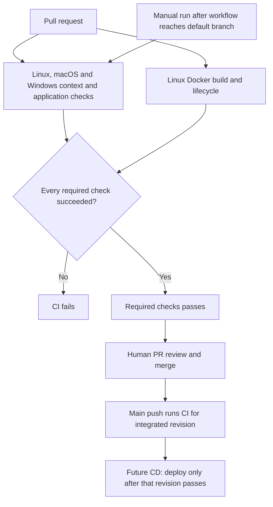

# Continuous integration and delivery

CI is implemented in [.github/workflows/ci.yml](../.github/workflows/ci.yml). Application deployment is not implemented: the owner chose automatic delivery after a reviewed merge to main and successful CI, while explicitly deferring hosting selection. [ADR 0002](adr/0002-deploy-main-after-successful-ci.md) records that policy; [issue 7](https://github.com/matthew-ngzc/fruit-box/issues/7) tracks the executable deployment work.

## Implemented CI

- Pull requests run the context/reference check, seven Python regression cases, locked npm install, TypeScript checking, rules/real-client room tests, compilation and a compiled two-client demo on Linux, macOS and Windows.
- Pushes to `main` run the same checks, so the integrated revision is verified independently of the pre-merge branch. Other branch pushes do not duplicate the PR run.
- `workflow_dispatch` permits a manual run once the workflow is present on the default branch. It does not make a not-yet-merged workflow dispatchable on GitHub.
- New CI runs cancel obsolete runs for the same PR/ref. Matrix jobs have ten-minute limits, and the aggregate gate has five minutes.
- A Linux Docker job builds the local container, checks health and real HTTP/WebSocket clients, tests stop/start and removes its containers on completion. This does not publish images or deploy a service.
- `Required checks` runs after the application matrix and Docker job and succeeds only if both results are success. Failure, cancellation, or skipping does not count as a successful matrix result. When additional mandatory jobs are introduced, add them to this gate and require all their results.
- Checks run on GitHub-hosted runners with read-only repository permissions and no deployment credentials. Checkout does not retain credentials.

The stable `Required checks` result can be selected in repository merge rules once this workflow is on main. This PR does not configure branch protection or claim that repository settings currently enforce it. Application type checking, rules/room tests and compilation now run in the same required matrix. The browser bundle builds with the application. Container build/lifecycle checks are local CI evidence; production publishing and hosted deployment remain unimplemented.

## Accepted delivery policy and unfinished implementation

The policy is automatic deployment after reviewed changes merge to main and required CI passes for the revision being delivered. A PR run, a manual run of another branch, or green documentation checks alone must not deploy the game. Passing CI does not authorize an agent to merge a PR.

The deploy job, host, artifact format, credentials, environment/network configuration and runtime health checks remain undefined. [ADR 0003](adr/0003-typescript-colyseus.md) settles TypeScript/Node/Colyseus; [issue 4](https://github.com/matthew-ngzc/fruit-box/issues/4) settles hosting. Do not substitute a placeholder command that prints a deployment message for a working delivery pipeline.

The deployment follow-up must preserve commit identity through application build and delivery, verify the actual HTTP/WebSocket service, report failed delivery and demonstrate recovery to a known-good version. It must also settle active-match handling when replacing a running server. The exact implementation and host access are part of that follow-up, not accepted architecture in this document.

## Operating the checks

Use `gh pr checks <number> --watch` for a PR and `gh run list --workflow ci.yml` to find runs. For failures, inspect `gh run view <run-id> --log-failed`. After the workflow is merged to the default branch, `gh workflow run ci.yml --ref main` requests a manual check run. Authentication is configured on the invoking machine.

Locally, run the same commands from the README: `python scripts/check_agent_setup.py` and `python -m unittest discover -s tests -p 'test_*.py'` (use `python3` where appropriate). Also run `npm ci`, `npm run typecheck`, `npm test`, `npm run build` and `node dist/scripts/room-demo.js` for the application. Actual GitHub run evidence validates the hosted environment; local success alone does not prove every runner or workflow event succeeded.

The CI change depends on the foundation's scripts and tests. Follow [stacked PR delivery](development-workflow.md#stacked-pr-delivery) to preserve a focused diff, land prerequisites first, and recheck the resulting integration after retargeting/restacking. The live dependency map belongs in the PR descriptions.

## References

- [GitHub event triggers and default-branch requirements](https://docs.github.com/en/actions/reference/workflows-and-actions/events-that-trigger-workflows).
- [GitHub workflow concurrency](https://docs.github.com/en/actions/how-tos/write-workflows/choose-when-workflows-run/control-workflow-concurrency).
