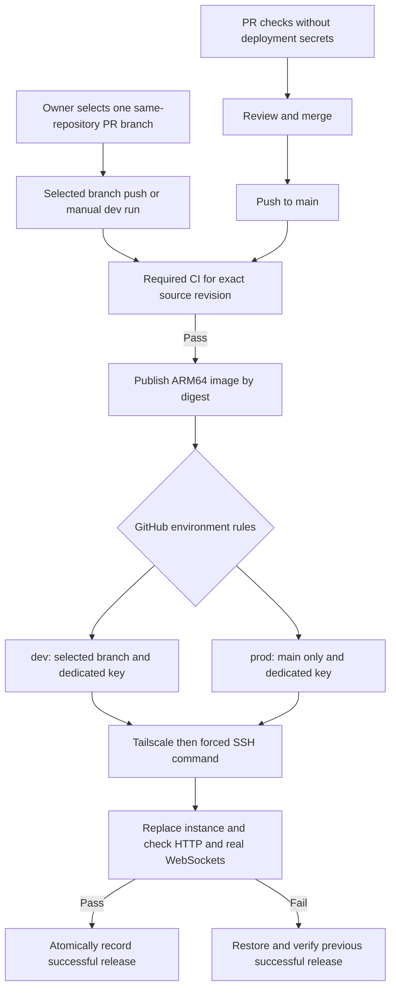

# Continuous integration and delivery

GitHub Actions tests Fruit Box on hosted runners and builds ARM64 images for the deployment host. GitHub Environments `dev` and `prod` separate deployment policies and credentials; they do not provide hosting. The owner selected one shared dev instance following a trusted PR branch and production following reviewed `main` changes. [ADR 0006](adr/0006-dev-and-prod-deployments.md) extends [ADR 0002](adr/0002-deploy-main-after-successful-ci.md). [Issue 7](https://github.com/matthew-ngzc/fruit-box/issues/7) tracks implementation and live acceptance.

## Checks and image delivery

[CI](../.github/workflows/ci.yml) checks repository context/references, Python regression tests, locked npm installation, TypeScript, game tests, compilation and the compiled two-client demo on Linux, macOS and Windows. A Linux Docker lifecycle job checks HTTP/assets, real WebSocket clients, solo/versus, reconnect and stop/start for the local and temporary-host profiles. `Required checks` fails if any required job fails, is canceled or is skipped. Ordinary PR checks receive no deployment credentials.

[Deploy](../.github/workflows/deploy.yml) runs for `main`, the selected `DEV_BRANCH`, or an explicit manual dev run matching that selection. It calls the same CI workflow for the exact revision being delivered. Only successful checks permit a native ARM64 build and GHCR publish. Images carry the full source SHA as an OCI revision label and are deployed by digest, never by a mutable `latest` tag. There is no self-hosted GitHub runner on the game host.

The deploy job enters the appropriate GitHub environment, checks the current branch revision, joins Tailscale as an ephemeral `tag:fruitbox-ci` node, and connects through ordinary OpenSSH. Separate forced-command keys accept only a pinned Fruit Box image and source SHA for their own environment. The host also verifies ARM64 architecture and the image's revision label. A short-lived, read-only workflow token is sent over SSH stdin for private GHCR pulls and kept only in a temporary Docker credential directory.



## Environment boundaries

| Contract | dev | prod |
| --- | --- | --- |
| Source | One selected same-repository branch with an open PR | `main` |
| Selection | `scripts/select_dev_branch.py <branch>` | Reviewed merges |
| Subsequent pushes | Automatically redeploy selected branch | Automatically deploy after CI |
| Compose project | `fruitbox-dev` | `fruitbox-prod` |
| Docker network alias | `fruitbox-dev` | `fruitbox-game` |
| Access | Tailscale-only host address on port 2568 | Existing Caddy/Cloudflare public game route |
| SSH key | Restricted to dev command | Restricted to prod command |
| State | Private host deployment root, `dev/` | Private host deployment root, `prod/` |

The game containers run non-root, with read-only filesystems, capability drops and CPU/RAM/PID limits. They do not mount host data or the Docker socket. Production publishes no host port. The dev-only overlay binds its port to the host's Tailscale IPv4 address, not all interfaces. Both environments still share the machine and Docker daemon; this is not isolation equivalent to separate hosts.

The shared dev instance hosts one experiment at a time. Selecting a different PR replaces that experiment, not production. A branch must contain this deployment implementation before it can execute the workflow; older PR branches need it incorporated first. Local agent-run development servers remain available independently.

## Initial setup

Run on the chosen Linux ARM64 Docker host as the account that already operates Docker, with GitHub CLI authenticated to this repository. Keep all addresses, keys and dashboard details out of public commits and logs.

```sh
python3 scripts/install_deploy_host.py --dev-branch <branch-containing-this-workflow>
bash scripts/setup_deployment_access.sh
```

The installer copies a fixed deployment command, Compose templates and real-client smoke checker to `~/.local/state/fruitbox-deploy/`. It provisions separate SSH keys, appends restricted entries without removing existing login access, pins the server's local SSH host key, creates GitHub environments/branch policies and uploads SSH credentials. It selects the initial dev branch but does not start or stop the game. Reinstall after reviewing a change to the host command; CI cannot upload arbitrary replacement host scripts.

The wizard guides the operator through the Tailscale policy and OAuth client steps. Add `tag:fruitbox-ci`, allow that identity only to the deployment host's TCP 22, and ensure existing broad rules do not grant it more access. Generate an OAuth client with writable `auth_keys` scoped to that tag. Enter its ID/secret in the local wizard, which stores them in both environments. It does not collect secrets in chat or commit them.

| Environment setting | Storage | Purpose |
| --- | --- | --- |
| `DEPLOY_HOST`, `DEPLOY_USER` | Environment variables | Private deployment destination; masked before workflow use |
| `TS_DEPLOY_TAGS` | Environment variable | `tag:fruitbox-ci` identity |
| `DEPLOY_SSH_KEY` | Environment secret | Forced-command key for this environment |
| `DEPLOY_KNOWN_HOSTS` | Environment secret | Locally verified SSH host key |
| `TS_OAUTH_CLIENT_ID`, `TS_OAUTH_SECRET` | Environment secrets | Temporary Tailscale connection |
| `DEV_BRANCH` | Repository variable | Current shared dev selection |

The installer permits only `main` in the prod environment and only the selected branch in dev. No required reviewer is added, so reviewed main changes can deploy automatically. Never store production deployment credentials as general repository secrets accessible to unrelated PR jobs.

### Bootstrap while this PR is stacked

GitHub does not expose `workflow_dispatch` until the workflow exists on the default branch. Until the stack lands, select this implementation branch through the installer and push it: the branch-local push trigger can run it. After finishing Tailscale authorization, rerun that push-triggered Deploy run with `gh run rerun <run-id> --repo matthew-ngzc/fruit-box`. Do not claim that a branch-local manual dispatch bypasses GitHub's default-branch requirement.

Keep the PR stack unmerged until human review. This setup does not merge application PRs or switch the public game to `main` prematurely.

## Select and operate dev

After the workflow is available on the default branch:

```sh
python3 scripts/select_dev_branch.py <feature-branch>
```

The helper validates the branch and its same-repository open PR, updates dev's branch policy and `DEV_BRANCH`, and dispatches its deployment. Subsequent pushes automatically deploy that branch after checks pass. The Actions UI can also rerun the selected branch through **Deploy → Run workflow**, choosing the same branch in the ref picker and `dev_branch` input. A run of an unselected branch cannot obtain the dev environment's credentials.

Use `tailscale ip -4` locally to find the private dev address; open `http://<tailscale-address>:2568/` from another tailnet device. It is intentionally not published through Cloudflare. Public dev access can be added later through a separate hostname and access policy.

## Replacement, rollback and production cutover

Each environment has a host-side file lock and separate success/previous release records. Workflow concurrency also serializes deployments. A failed pull or identity check leaves the running game untouched. Failed startup or real-client smoke checks restore and verify the previous successful release; on a first failed deployment, the new instance is removed. The workflow remains failed even when recovery succeeds. If recovery also fails, the error explicitly requires operator intervention.

For a managed environment, read its private `previous.json` and deploy that recorded image/SHA locally through the same command:

```sh
python3 ~/.local/state/fruitbox-deploy/deploy_host.py --environment <dev-or-prod> <recorded-image-digest> <recorded-commit>
```

Private GHCR images require a usable local registry login for manual recovery; automated recovery uses the current workflow's short-lived token. Preserve the previous image locally rather than pruning it immediately.

**Production migration is separate from installing CI/CD.** The host command refuses the first managed prod deployment while the legacy `fruitbox-trip` game is running. After the reviewed stack has reached main, arrange a quiet period, record the legacy Compose/image rollback command, stop only the legacy game, then allow the tested main release to create `fruitbox-prod`. Preserve Caddy's `fruitbox-game` upstream alias, existing authentication gateway, Cloudflare route and webhook services. If that first release fails, restart the legacy game from its private recorded Compose configuration. Verify public authentication and a real WebSocket match before declaring cutover complete.

There is no live-match migration or zero-downtime claim. Replacing a game instance ends its in-memory rooms and active matches; browser-local solo records are separate. Deploy during a quiet period and tell active testers before replacing dev. GitHub reports failed checks/deployments and retains the exact revision and image digest.

## Verification and references

Local application and host-unit checks do not prove Tailscale access or hosted workflow permissions. Record a real dev deployment, automatic update after another push, blocked bad checks, failure/rollback, and public prod cutover separately. Missing credentials or an unmerged production stack remain explicit acceptance items in the PR.

- [GitHub Environments](https://docs.github.com/en/actions/how-tos/deploy/configure-and-manage-deployments/manage-environments).
- [Workflow dispatch requirements](https://docs.github.com/en/actions/reference/workflows-and-actions/events-that-trigger-workflows#workflow_dispatch).
- [Tailscale GitHub Action](https://github.com/tailscale/github-action).
- [Native ARM64 GitHub runners](https://docs.github.com/en/actions/reference/runners/github-hosted-runners).
- [Temporary hosting](temporary-hosting.md) for the earlier manual profile.
