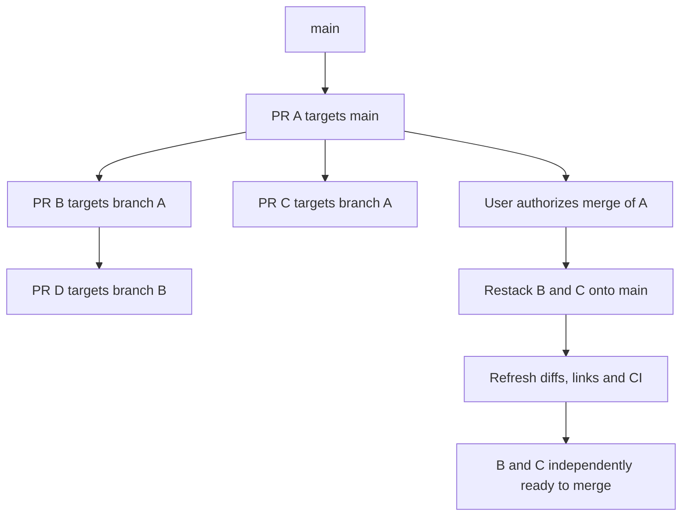
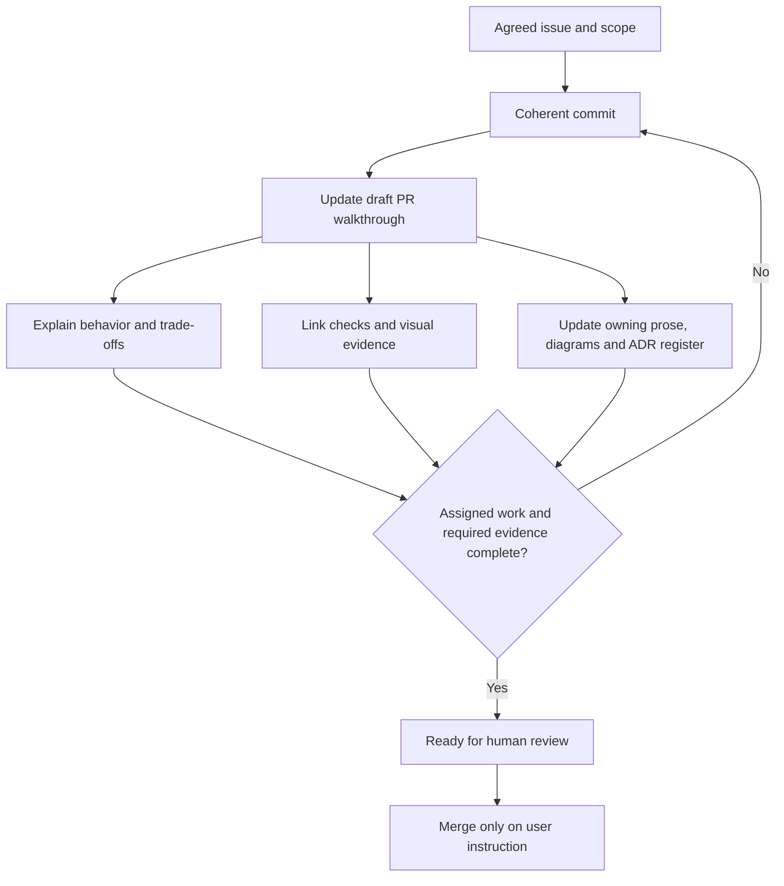

# Development workflow

GitHub Issues is the work tracker. GitHub PRs are the unit of delivery. The `gh` CLI is the interface for both. This project adapts Matt Pocock's published idea-to-ship flow: design discussion, spec, tickets, implementation, review, and retrospective. [Primary workflow reference](https://www.aihero.dev/), [vertical-slice and TDD guidance](https://www.aihero.dev/skills-post).

## Shape before implementation

`CONTEXT.md` defines domain terms; `docs/design-session.md` distinguishes confirmed rules from open decisions; `docs/adr/` records consequential choices. Research notes are evidence, not automatically accepted architecture. TypeScript/Node/Colyseus is accepted in ADR 0003; the deployment route remains undecided.

Synthesize agreed behavior into the parent specification issue. Extract small implementation issues that deliver observable behavior across the necessary layers. For example, prefer "two guests join a room and see the same board" over separate tickets for database schema, backend endpoints, and frontend components. Exploratory prototypes and decision tickets are appropriate when an implementation choice is unresolved.

## Issue contract

Every substantive issue includes:

- Problem and desired outcome.
- Scope and explicit exclusions where needed.
- Checkable acceptance criteria.
- Verification method and relevant edge cases.
- For visual work, the evidence needed to demonstrate the changed appearance or interaction.
- Blocking dependencies, using native GitHub relationships when available or explicit issue links otherwise.
- Handoff mode: autonomous after requirements settle, or human decision/review required first.

Keep issues current when the design changes. Avoid turning every small edit into administrative overhead; one cohesive issue can cover several closely related files.

## Implement and verify

Work on a focused branch. Use public interfaces for behavior tests, one failing behavior followed by its implementation and refactoring. Multiplayer tests should exercise actual command ordering and recovery rather than mirror internal functions. Verify phone interaction on real devices when the behavior depends on touch, viewport, or app backgrounding.

Use the repository's scripts as the source of truth. The first room slice has TypeScript checks, rules/transport tests, a build and a compiled demo; see [room setup](versus-rooms.md). Those checks do not establish playable gameplay or device acceptance.

## Deliver through a PR

The PR describes the problem and final behavior for someone who has not read the chat. Reference its issue and acceptance criteria, summarize meaningful verification, and disclose outstanding limitations. Keep scope small enough to review. Use closing keywords only for issues fully resolved by merging the PR; research that informs a decision may reference the decision issue without closing it.

Review against the originating issue and repository instructions, fix actionable findings, and run applicable checks before presenting the PR. Human review and merging are separate steps; do not enable auto-merge or merge without a user instruction.

Use `gh` structured options and body files; attach created PRs to the Codex chat. GitHub remains the authoritative record of ticket and PR status. Local documents hold durable rules, decisions, and evidence rather than a duplicated status board.

### Stacked PR delivery

Plan a delivery map before starting a multi-PR issue: give each PR its assigned slice, immediate prerequisite, base branch, independent mergeability, required evidence, and ready-for-review gate. Keep the live dependency map in GitHub PR descriptions rather than duplicating project status in local docs.

Start independent work from the current `main`. For work that needs an unmerged PR, branch from that prerequisite's head and target its branch with `gh pr create --base <parent-branch>`. Each child diff must contain only its assigned changes relative to that parent. Siblings sharing a parent can proceed independently; create a deeper chain only when a slice actually needs another slice's changes.

Once a PR is ready for review, continue the next agreed slice without waiting for review or merge when its requirements are settled. An unmerged code dependency is handled by stacking; an unresolved product decision, missing access, or required evidence can still block the dependent work. Readiness and continuation do not authorize merging.

Every stacked PR must identify:

- Its parent and any known children, using PR links; label children `stacked`.
- Its base branch and the parent head SHA used as the branch point. Update this SHA when restacking changes the incorporated parent revision.
- The ancestor-first merge order, independent mergeability, and agent/person responsible for restacking. If nobody else is assigned, the agent continuing the child owns it.
- Its own evidence and remaining blockers. A complete child may be ready for review while its parent remains open.

Keep parent descriptions linked to their children. Preserve prerequisite branches until all dependent PRs have moved off them. Review each PR against its declared parent; when the user requests merging a child, check the full dependency chain and report any prerequisite that still needs approval. Merge a child into `main` after its prerequisites land and its integration checks pass; merging it into its temporary parent would collapse the delivery boundary.

Arrows show dependency order. D still targets B until B lands; B and C do not depend on each other.

#### Restack after a parent changes or merges

1. Inspect the current remote heads, open PR bases, worktrees, and merge result with `git` and `gh`. Record the old parent SHA and child head before any rewrite; keep local work safe and coordinate with any agent using the child branch. Restacking is agent-driven with Git/gh; no automatic restacking service is configured.
2. If the parent changes while open, incorporate its reviewed head into each direct child and recheck the child's diff. Rebase only child-owned commits onto the new parent, or merge the parent into the child when preserving shared history is needed. Propagate changed parent heads down deeper stacks.
3. After the parent merges, fetch `main` and retarget direct children with `gh pr edit <child-number> --base main`. If the child's parent commits are already ancestors of `main`, a base change may suffice. After squash/rebase merges, replay only the child's commits onto `main` using the recorded old parent tip as the boundary; a base edit alone can leave prerequisite changes in the diff. Inspect that boundary before choosing a rebase command, especially when the child contains merge commits. Retargeting and rewriting may be ordered to suit GitHub's current base, but verify the final state before handing off.
4. Before publishing rewritten history, verify that the remote child head still matches the recorded value. For a branch owned by this work, use an explicit expected-SHA `--force-with-lease` when a non-fast-forward push is needed; stop and reconcile unexpected remote changes. Coordinate shared branches before rewriting. Preserve parent branches until no open child uses them.
5. Check the new base/head diff contains all and only the child's assigned work. Resolve conflicts, run applicable checks against the updated integration, and wait for fresh PR CI. If a base-only edit produces no run, arrange a fresh check of the updated PR integration and record its base/head revisions; an earlier green result does not cover that change. Update commit walkthrough links, parent revision, stack map, and mergeability claims; remove `stacked` when no unmerged prerequisite remains. Then repeat for affected descendants.

An earlier green run is evidence for the earlier revision. Retargeting/restacking requires checking the resulting integration again; follow [CI/CD](ci-cd.md) for the actual checks. Continue to keep PRs open for human review until a user merge instruction applies.

### Detailed review contract

Use the owner's Cooking Spree PRs as the style reference: [PR 6's behavior, trade-offs and evidence](https://github.com/matthew-ngzc/Cooking-Spree/pull/6), its [focused save-flow commit walkthrough](https://github.com/matthew-ngzc/Cooking-Spree/pull/6#issuecomment-5984709101), and [PR 3's maintained-diagram approach](https://github.com/matthew-ngzc/Cooking-Spree/pull/3). Adapt the presentation to Fruit Box; Android constraints and model-specific delegation policies are not this project's requirements.

Open a draft once the first reviewable commit is available and maintain it as work proceeds. Each PR explains the outcome and why it matters, assigned scope and dependencies, material decisions/alternatives/trade-offs, a behavior-grouped changelog, verification, visual evidence, documentation/ADR updates, deferrals, and reviewer focus. Details should make the result reviewable without checking out the branch; explain the final implementation rather than narrating abandoned attempts.

For each coherent commit, add an inline walkthrough or link to one in a PR comment. Record the SHA/title, significance and resulting behavior, a concrete scenario or diagram when useful, representative changed-line links, and verification/evidence. Prefer immutable commit-pinned file/line links or precise PR diff anchors; a list of filenames alone is insufficient. Update links and dependency claims after rebasing or restacking.

Flow, state, ownership, failure-handling, or architecture changes need a focused Mermaid diagram when it clarifies the contract. Keep the maintained copy beside the owning prose, route it from the documentation index, and link/embed it in the walkthrough. See [documentation maintenance](doc-maintenance.md) and the [ADR register](adr/README.md). Use diagrams to explain relationships and screenshots/recordings to demonstrate actual visual behavior; one does not replace the other.

Mark the PR ready when its assigned scope, walkthroughs, documentation, and applicable evidence are complete. Later work assigned elsewhere does not keep it in draft. Explicitly record unavailable checks and their effect on acceptance; a required unverified outcome remains pending. PR readiness, passing CI, and checked progress boxes do not imply user acceptance of an ADR or authorization to merge.

## Visual evidence

Visual changes require clear evidence in both the issue and PR. Embed screenshots or a playable screen recording, or link the same accessible media from both places. Planning issues can describe the evidence to capture; attach the actual result when delivering the change.

- Use screenshots for static appearance and before/after comparisons. Keep comparisons at matching viewport sizes and states when practical.
- Use recordings when interaction, animation, or a sequence of states explains the change better. Prepare the sequence before recording so actions proceed smoothly and go directly to the changed behavior.
- Keep clips concise. Trim setup, trailing footage, and long idle gaps between actions; do not leave the reviewer waiting through pauses such as 30 seconds of inactivity. Split unrelated demonstrations into separate focused clips.
- Stage the scenario before capture and use a continuous controller with condition-based waits when practical. Match the Cooking Spree pacing: first meaningful input within two seconds, no unexplained idle gap over three seconds, and hold the final result for one to two seconds. Explain naturally slow operations when their duration is part of the evidence.
- Make touch/click inputs visible when the capture method supports it, and identify the device, browser and viewport. Capture internal app audio when sound changes or helps demonstrate the result; keep microphone audio off unless intentional narration is requested, and disclose unavailable audio capture.
- Show the actual implementation being reviewed. Label prototypes and before/after views clearly, identify relevant device/viewport context, and add a short caption explaining what the reviewer should observe.
- Preserve real-time behavior when evidence supports a timing, latency, or smoothness claim. Label cuts or speed changes that affect interpretation; editing must not conceal the behavior being evaluated.
- Review the screenshots or play back the clip before posting. Check readability, media access, and whether the changed behavior is clearly visible. Keep credentials and unrelated private content out of the capture.

If the required runtime or capture capability is unavailable, state the missing evidence explicitly and keep visual verification pending. Source inspection and automated tests do not substitute for visual evidence. Changes without a visual effect can mark this evidence requirement not applicable.

## Initial work map

The bootstrap PR publishes the existing research, glossary, decisions, and this workflow. Open human-decision tickets cover backend/framework choice and the intended initial hosting route. A mobile interaction prototype can resolve selection usability before the main implementation. Create implementation slices after their prerequisites are settled; preserve the user's later solver and additional-mode ideas as future scope.
