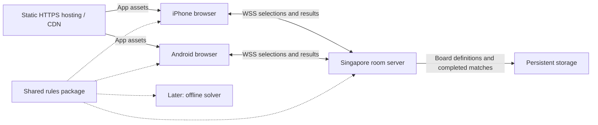

# Architecture and mode recommendations

Research and design checked 29 October 2026, Singapore time. Confirmed product choices are in [the interview log](../design-session.md); the stack below is a recommendation, not an accepted implementation decision.

## Recommended first release

Keep solo play and add private two-player shared-board competition. Use the newer repository's certified-solvable initial boards. Send a room link to a friend; both use the same browser app on iPhone or Android. Start with a server in Singapore and measure actual latency on Wi-Fi and mobile data before considering a second transport.

Use TypeScript for the web client, shared rules, and Node.js server. React with Vite is a reasonable UI choice; the board itself can remain a small DOM/CSS grid. There is no simulation or rendering requirement here that justifies adopting a large game engine. A PWA can add home-screen installation later. Apple documents home-screen web app capabilities and web push; push is optional for this first release. [Apple's web app overview](https://webkit.org/blog/13878/).

The source repository is already separated into a pure engine and DOM orchestration. Preserve that boundary when porting it into modules. [Upstream README](https://github.com/weizixiao/fruit-box-game/blob/de7b1f59bff021d76f5138af17bed37220f7783e/README.md).

## Proposed components

Suggested code boundaries:

- `packages/rules`: board generation, seeded randomness, selection inspection, clear application, legal-move enumeration, replay verification. Pure functions with no network or UI dependencies.
- `apps/web`: room flow, touch input, board rendering, local solo play, selection feedback, reconnect display.
- `apps/server`: room membership, authoritative board, request ordering, deadline, scores, pause budget, snapshots, and match results.
- `tools/solver`: deferred offline experiments using the same rule definitions and board fixtures.

Solo play can be local. Verified multiplayer scores and shared-board consistency require authority outside either player's client. Do not put a database round trip between receiving a clear and applying it to the live room. For private matches, a process crash can void the current match; durable in-progress recovery can be added if it becomes a product requirement. Save completed matches transactionally.

## Room server options

| Option | Why use it | Cost/trade-off |
| --- | --- | --- |
| TypeScript/Node with Colyseus | Room lifecycle, authoritative state sync, and reconnect primitives fit the game | Framework/version learning and state schema conventions |
| TypeScript/Node with a small WebSocket server | Very small command vocabulary and direct control | You own reconnect, membership, snapshots, deduplication, and room routing |
| Cloudflare Durable Object per room | Managed room ownership and WebSocket coordination | Provider-specific runtime, storage, placement and lifecycle behavior |

Recommendation: Colyseus for a first multiplayer implementation, keeping `packages/rules` independent. Its official docs describe server-mutated room state and client requests, and its reconnect flow sends a full state snapshot. The default state-patch interval is 50 ms; treat that as an additional latency contributor and tune or use carefully ordered immediate acknowledgements when measuring the game. Do not assume choosing a framework solves conflict fairness. [State sync](https://docs.colyseus.io/state), [rooms](https://docs.colyseus.io/room), [reconnection](https://docs.colyseus.io/room/reconnection).

Deploy the frontend as static files on HTTPS hosting. Deploy the room server as a long-lived service/container with secure WebSocket support in Singapore. These are separate deployment concerns: a frontend CDN does not put the authoritative room near both players. Start with one server process and one owner for every room. Add multi-process routing/shared presence only when usage requires it. Host compatibility, available regions, current pricing, and operational effort should be checked when selecting a provider; none is selected here. [Colyseus deployment](https://docs.colyseus.io/deployment). Cloudflare also documents a Durable Object WebSocket implementation, which is an alternative to the Node room server rather than an additional component. [Durable Object WebSocket example](https://developers.cloudflare.com/durable-objects/examples/websocket-server/).

## Processing a clear

1. The phone draws the selection and computes its local sum immediately.
2. On release, send a unique command ID, match ID, last-seen board revision, rectangle bounds, and the intended active cell IDs. The server derives player identity from the room session.
3. The room owner checks membership, bounds, finite coordinates, running state, timer, command deduplication, current selected fruit, and sum ten.
4. In one serialized operation, deactivate fruit, credit its count, advance revision, and append a committed event. Do not `await` unrelated work between validation and state mutation.
5. Return accepted/rejected plus an authoritative revision. Both phones apply committed events or request a snapshot if they missed revisions.

Do not reject a request just because its revision is old: another player might have cleared a disjoint region. It can still succeed if the fruit in its intended selection is unchanged and valid. Reject overlapping changed selections and explain that the fruit was already taken. Disconnected submissions must never be buffered and awarded as if they happened before expiry or pause; revalidate them against current match state.

At pointer-down, do not reserve fruit: someone could hold a drag to deny the board. Priority is decided at submission receipt. Duplicate delivery or reconnect retry must return the original result without adding points. Use a server-issued match/phase token so a delayed request from before a pause or rematch cannot become a new action after resumption.

Use logical coordinates or explicit included-cell bounds in the protocol. The upstream uses strict center-point inclusion; choose and test a canonical mapping to avoid floating-point edge disagreements. Normalize hit-testing in the shared rules package. [Upstream selection implementation](https://github.com/weizixiao/fruit-box-game/blob/de7b1f59bff021d76f5138af17bed37220f7783e/engine.js#L211-L242).

## Latency and fairness

First-valid-server-arrival is the confirmed policy. It is consistent and auditable; it cannot prove who physically released first. Client clocks and claimed timestamps do not establish that. The lower-latency player can win a close contention even if they acted slightly later.

WebRTC data channels can connect browsers directly, but need signaling and ICE negotiation. STUN helps discover direct paths, and TURN relays may be needed when a direct path fails. Same Wi-Fi can make a direct path practical, but does not guarantee reachability through AP isolation, VPNs, or restrictive networks. A host phone deciding conflicts has an inherent local-action advantage, and losing/backgrounding it disrupts authority. A symmetric peer arrangement still needs a common rule for conflicting clears. [MDN connectivity](https://developer.mozilla.org/en-US/docs/Web/API/WebRTC_API/Connectivity), [signaling](https://developer.mozilla.org/en-US/docs/Web/API/WebRTC_API/Signaling_and_video_calling).

WebRTC is not intrinsically unreliable: its data channels support both reliable and partially reliable delivery, and ordered delivery is the default. If used later, committed clears need reliable delivery or acknowledgements/retry/recovery; replaceable cursor updates can tolerate loss. [RFC 8831](https://www.rfc-editor.org/rfc/rfc8831.html), [MDN ordered data channels](https://developer.mozilla.org/en-US/docs/Web/API/RTCDataChannel/ordered).

Recommendation: measure the Singapore WSS path first. Log round-trip time percentiles, jitter, server queue/processing delay, release-to-confirmation delay, and rejected-overlap rate. Immediate local highlighting can feel responsive without promising that a clear has already been awarded. A short pending visual is a simpler initial choice than fully optimistic removal and rollback. Pick a transport based on measured end-to-end behavior, not the belief that P2P is always faster.

## Timers, pause, and reconnect

Confirmed: 120 seconds of active play, or until the board is empty. A dead board remains until time expires; do not auto-end on no moves. Display a no-moves notice if useful. Equal scores end in a draw.

Confirmed: disconnects do not stop the clock; allow rejoin. Recommend a 30-second reserved seat and server snapshot on rejoin, without extending the match. If a deliberate pause is active, the pause rule applies independently of connection status.

Confirmed: either player can immediately pause, spending one of their two chances per match. Maximum pause duration is 30 seconds; both-ready can resume earlier. This permits up to four pauses and 120 seconds of added wall-clock duration in a two-player game. The active game timer must freeze during pauses and retain the exact remaining duration.

Confirmed pause details: hide the board from both players, cancel active drags, and ignore further pause requests while already paused without spending another chance. Recommended presentation: show pause owner/budget/countdown. Preserve spent chances across rejoins. Process pause and clear commands in one room order: a clear accepted before the pause stays accepted; later clears are rejected while paused. Hiding the board reduces free analysis time but cannot stop someone remembering it or taking a screenshot.

## Guest access and future accounts

Confirmed: start with guest nicknames and private links/codes, while allowing future accounts such as Google login. Recommend an internal player identifier independent of nickname and login provider. A later login can link a proven guest session to an account, preserving eligible history without treating matching nicknames as proof of identity. The identity lifetime, saved history, and cross-device recovery still need definition when implementing persistence.

Google login is compatible with any of the proposed backend languages. Google's server-side verification guide says to use its verified `sub` claim as the external account identifier; map that identifier to the game's own player identity rather than using nickname or email as the key. [Google Identity documentation](https://developers.google.com/identity/gsi/web/guides/verify-google-id-token).

The TypeScript/Node stack above remains a recommendation. The user is also considering Java, Python, and Rust; see [technology-options.md](technology-options.md) before accepting a runtime/library ADR.

Use the server's deadline as authority and derive the client countdown from an estimated clock offset. Do not decrement a counter once per callback. Browser background tabs throttle timers, so elapsed wall-clock time and state resynchronization matter. [MDN Page Visibility API](https://developer.mozilla.org/en-US/docs/Web/API/Page_Visibility_API).

## How the other modes differ

| Mode | State | Appeal | Main limitation |
| --- | --- | --- | --- |
| Separate-board live race | One initial board, separate evolving copies | Fair puzzle comparison with little move contention | Less direct interaction; phone vs mouse still matters |
| Asynchronous challenge | Same board and rules, attempts at different times | Easy invitation and flexible play | Creator/replay knowledge advantage; offline timing and human-only play are hard to verify |
| Shared-board competition | One evolving board, separate scores | Interaction, denial, speed and tactical opportunity | Network contention and opponent-created dead ends |
| Shared-board cooperation | One evolving board, combined score | Communication and coordination | A weaker move can break a full-clear path; one player may dominate |

For later separate-board races on phones, show the player's own full-size board with opponent score/progress. Two complete boards shrink touch targets and divide attention; an optional opponent miniature or post-game replay is a better starting point. Co-op can test target pings or an agreed division of the board; do not assume a hard spatial partition preserves the original puzzle.

For asynchronous challenges, store the actual 170 values, board/rules/generator versions, duration, and an ordered move log. A seed alone can change meaning after a generator update. Server replay proves that moves are legal; it does not prove a human solved the board unaided within the claimed offline time. Specify whether attempts are repeatable and whether first-attempt scores are special before adding competitive rankings.

## Solver boundary and testing priorities

Keep the generator's full-clear witness server-side in multiplayer. Public seed plus public generator can regenerate the witness, so hiding just a `solution` JSON property is not a serious bot defense. Private friend matches need clear rules and sensible validation; they do not need a promise of bot-proof play. The deferred offline solver should benchmark both fresh certified boards with witnesses withheld and arbitrary/deviated boards. [Solver research](solvers-and-complexity.md).

Before a playable release, verify conservation of points (one fruit credited once), conflicting and disjoint simultaneous submissions, duplicate/reordered delivery, rejection after expiry, pause/clear ordering, pause budgets across reconnects, full snapshot recovery, and consistent touch hit-testing on real iPhone and Android hardware. These are the meaningful multiplayer risks; renderer snapshot tests alone would miss them.

## Other useful reference

[AppleGame+](https://apple.oshizi.com/) already documents friend rooms, room codes, multiplayer and spectator flows; it is useful product research, not evidence that its internal architecture or shared-state semantics match this proposal. Its author's [board-generation study](https://apple.oshizi.com/about/board-generation/) is interesting empirical evidence, but its rejection-sampling hypothesis should not replace the direct GameSaien source analysis in [the origins report](origins-and-generation.md).
