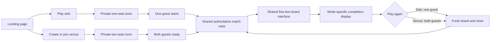

# Solo play preview

Choose **Play solo** on the landing page; nickname is optional and defaults to You. Then choose **Start solo round**. A single guest can play the same board/selection interface without waiting for a friend. Solo still connects to the running game server; start/stop it through [Docker Desktop/Compose](local-docker.md).

## Shared interface and rules

Solo uses the same certified 17-by-10 board generator, free rectangle selection, center inclusion, pending confirmation, authoritative scoring and 120 active seconds as versus. Empty board also ends the round; a no-moves board waits for the deadline. This preview reuses the existing two-pause budget and 30-second pause cap, with one-player Resume returning to play immediately. Disconnection leaves the clock running and allows identity/score recovery until finish. A server restart loses the attempt. No hint/solver, saved best score, account or offline mode is added.

The page shows one score, solo Start/Resume copy and **Round complete** with the final score. It hides room-invite controls and opponent/draw/winner copy. **Play again** immediately starts a fresh certified board in the same room, resetting score, time and pause allowances. **New game** returns to the landing page instead. Resume is a large red action in the middle of the pause screen; solo resumes immediately. The landscape/sidebar and fullscreen behavior are shared with [mobile interaction](mobile-interaction.md). The owner requested this mode to validate appearance; longer-term solo pause/persistence/features can be decided separately.

## Authoritative room ownership

[The room module](../src/game-room.ts) owns the shared room lifecycle. The versus registration has two seats and starts when both are ready. The solo registration fixes capacity at one and starts when its guest is ready; client options cannot change that capacity/mode. Public state declares the mode so the client does not mistake a one-person versus lobby for solo. Solo room IDs do not admit a second guest, and future invitations/accounts are not inferred from solo mode.

## Verification and acceptance

Real Colyseus client tests verify one-seat admission, start without a peer, valid clear and duplicate suppression, one-player pause/resume, reconnect preserving mode/identity/score, and rejection of client attempts to turn a versus room into solo. Replay tests verify reset semantics and stale-round rejection. Existing versus tests remain required. The container smoke starts/resumes both modes through the published server. Browser checks and screenshots are recorded in [issue 19](https://github.com/matthew-ngzc/fruit-box/issues/19) and the [round-controls follow-up](https://github.com/matthew-ngzc/fruit-box/issues/21); source inspection is not physical-device acceptance.
