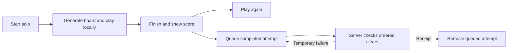

# Solo play

Choose **Play solo** on the landing page. Nickname is optional and defaults to You. Select **Start** to begin. Once the page has loaded, the browser can generate a board and play the attempt with the connection interrupted.

## Shared rules and controls

Solo uses the same certified 17-by-10 board generator, free rectangle selection, center inclusion and scoring as versus. A valid selection clears immediately on release. Each round ends after 120 active seconds or when the board is empty. A board with no moves waits for the deadline. Solo has two pauses of up to 30 seconds each, with immediate resumption when the player selects **Resume**.

The page shows one score and no room or invite controls. **Play again** starts a fresh certified board and resets score, time and pauses. **New game** returns to the landing view, including during a connection interruption.

## Result delivery

When an attempt finishes, the browser queues its attempt ID, starting seed and ordered clear rectangles. It retries after a failed upload and when the browser comes online. The outbox uses browser storage across reloads when available.

The server bounds the request using the existing HTTP limits, regenerates the starting board and applies the shared clear rules. A valid replay returns the derived score and attempt ID. Repeating the same submission returns the same receipt. The server validates the move sequence for casual play and keeps no result record. Personal history belongs to [issue 31](https://github.com/matthew-ngzc/fruit-box/issues/31).

The hosted browser uses this local flow. The existing one-seat Colyseus endpoint stays available to older clients. Live versus still uses the [authoritative room](versus-gameplay.md).

## Verification

HTTP tests verify that the server derives the score even when a caller supplies a different score, that a repeated request returns the same receipt, that reusing cleared fruit fails, and that a certified full clear scores 170. Browser verification covers starting offline, immediate scoring, pause and deadline, replay, and uploading a queued result after reconnect. [Issue 29](https://github.com/matthew-ngzc/fruit-box/issues/29).
