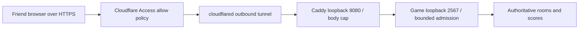

# Temporary friend hosting through Cloudflare Tunnel and Caddy

This is a manual hosting profile for the owner's requested Mac/Pi4 route, not automatic deployment or acceptance of the open PR stack. Review and run the security-fix branch including its prerequisites. Keep the service stopped until the host checks below pass. A tunnel provides connectivity; the hostname is public unless an access policy restricts it.

## Same-host setup

Use a supported, updated OS; on Pi4 prefer 64-bit Raspberry Pi OS. Docker's pinned Node image supports ARM64 and ARMv7. From the repository root:

```sh
docker compose -f compose.host.yaml up --build --detach --wait
docker compose -f compose.host.yaml ps
docker compose -f compose.host.yaml exec game node --version
node scripts/check_container.mjs
```

The smoke client needs local npm dependencies and a patched Node installation. For another published port set `FRUIT_BOX_PORT` before `up`, update the Caddy upstream, and set `FRUIT_BOX_TEST_URL` for the smoke command. Stop with `docker compose -f compose.host.yaml stop`; restarting/rebuilding ends in-memory matches. This uses a separate `fruit-box-host` project: stop any old LAN test instance on the same port first. Use this file **by itself**, not as an overlay on `compose.yaml`, so Compose cannot retain an all-interface port mapping.

The profile binds `127.0.0.1:2567`, runs as the image's non-root user, drops capabilities, prevents privilege escalation, uses a read-only filesystem, and caps RAM at 256 MiB, heap at 128 MiB, CPU at one core and processes at 128. These constrain host impact; a container can still be denied service. No host directories or Docker socket are mounted. The existing [LAN development profile](local-docker.md) deliberately remains available.

Copy [the Caddy template](../deploy/Caddyfile.example) into your existing private configuration and replace its example hostname. It listens on loopback port 8080, limits request bodies to 4096 bytes, and proxies HTTP/WebSocket traffic to loopback port 2567. Validate before reloading your existing Caddy service:

```sh
caddy validate --config /path/to/your/Caddyfile --adapter caddyfile
```

Configure only the game hostname's tunnel service as `http://127.0.0.1:8080`. Preserve the public Host header. Cloudflare supplies public HTTPS; this loopback hop is HTTP. Require a Cloudflare Access allow policy for your friends' email identities across the **entire hostname**, including matchmaking and WebSocket paths. Test a signed-out/private browser is denied, an allowed friend can load the page and join, and two phones can pause/resume/reconnect. Keep Caddy's administration port, cloudflared metrics, SSH, Docker and other host applications out of tunnel ingress. Store tokens and private configuration outside Git. No router port forwarding is needed.

If Caddy/cloudflared run in containers, their `127.0.0.1` is their own container. Do not copy this template unchanged or fix it by publishing the game to every interface. Use a deliberately configured shared Docker network, upstream `game:2567`, and no host publication for the game; restrict the Caddy listener to the tunnel connector's network. Verify that alternate route against your actual Compose setup before hosting. The repository does not configure or inspect an existing proxy/tunnel installation.



## Application limits and remaining exposure

Matched framework requests have a 4096-byte body budget checked against both Content-Length and actual stream bytes before parsing, a finite read deadline and bounded concurrent reads. This hook is before Colyseus parsing; ordinary Express middleware is bypassed by matchmaking. Only the implemented `startServer`/`listen` startup is covered; switching to the framework's serverless prereader requires a fresh boundary review.

All non-GET/HEAD/OPTIONS framework requests also share a 60-request burst, replenishing ten requests per second. This includes reconnect, so reopening sockets cannot reset an unlimited protocol workload; exhausted budgets return 429 with Retry-After. Health/assets remain available. WITH_ERROR drops close the old socket before awaiting reconnect, because Colyseus uses that code for both rate violations and legitimate early-reconnect races; otherwise an old socket could survive replacement. Ordinary interrupted matches retain their reconnect contract.

Solo and versus share a per-server budget: at most 32 live rooms, four initial creation tokens, one replenished per second. The gate runs before generation, so `create`, `joinOrCreate` and encoded aliases cannot bypass it. Room disposal releases capacity; failed creation also releases it. Join/reconnect does not spend creation tokens. Budgets use no forwarded IP headers, avoiding proxy identity spoofing. A guest is disconnected after excessive protocol messages (20 per second, with the framework's window accounting); individual frames retain the transport's 4 KiB cap and disabled compression. These conservative defaults target friends, not a measured public capacity.

An allowed guest can still occupy available rooms, solve automatically, retain the board during visual pauses, or consume the shared admission budget. Room codes are bearer invitations, nicknames are not authenticated accounts, and private listing is not an access gate. Generation remains synchronous; the limits reduce repeated work but do not promise latency under load. Gate ingress, keep the host disposable and stop it after playing.

## CVE and patch checks, 30 October 2026

The online npm audit returned **zero known advisories** for the current lockfile. This does not scan Node, Debian, Linux, Docker, Caddy or cloudflared. The existing Docker digest already matches Node **22.23.4**, the Node 22 release containing the [21 October security fixes](https://nodejs.org/en/blog/vulnerability/october-2026-security-releases). The version tag is now explicit without changing that digest. One fixed issue is CVE-2026-111497 in Brotli decompression; exposure depends on processing attacker-controlled Brotli, so an old runtime alone is not proof this app has an RCE path. HTTP middleware and transitive libraries must still be considered. Native startup refuses older known pre-fix versions in supported 22/24/26 release lines.

The audit shell used Node 22.17.0, so it must be updated before native hosting. A fresh container build uses the pinned patched runtime independently of host Node. A pinned digest does not update itself: refresh the version/digest after checking new advisories, rebuild and scan the resulting image. Updating the host does not update the container's Debian packages; rebuilding an unchanged digest does not fetch a newer base.

Run locally on the intended host and keep private output out of public issues:

```sh
node --version
caddy version
cloudflared --version
docker version
docker compose version
docker compose -f compose.host.yaml images
docker scout cves fruit-box-host-game --platform linux/arm64 --only-severity critical,high
npm audit --omit=dev
```

Use `linux/amd64` for an Intel Mac and the platform actually running on your machine. Scan both the built application image and its base if investigating inherited packages. **Container package clearance remains pending:** Docker Scout v1.18.3 was available during this audit but refused analysis until Docker login; no OS-package CVE result was obtained. Authenticate locally or use an equivalent current SBOM/CVE scanner, and assess every applicable high/critical result before exposure. Do not infer an empty scan from a failed command.

On Raspberry Pi OS run `sudo apt update`, review `sudo apt full-upgrade`, then reboot to load kernel/firmware fixes. Confirm `cat /etc/os-release`, `uname -r`, and `apt list --upgradable` afterward. Use distro security status/package revisions rather than comparing kernel upstream versions alone: distributions backport fixes. Raspberry Pi publishes [daily image CVE reports](https://www.raspberrypi.com/security/) and [OS update instructions](https://www.raspberrypi.com/documentation/computers/os.html). No particular Linux CVE can be cleared without your actual OS/kernel/package inventory. Avoid using `rpi-update` as a routine security-update mechanism.

On Mac install available supported macOS security updates and reboot; compare your release with [Apple's security release list](https://support.apple.com/en-us/100100). Update Docker Desktop as well: its Linux VM/kernel and containers have their own patch state. Update Caddy/cloudflared using their installation method and review the [Caddy advisories](https://github.com/caddyserver/caddy/security/advisories) and [cloudflared advisories](https://github.com/cloudflare/cloudflared/security/advisories). Caddy's current upstream release checked during the audit is [2.11.7](https://github.com/caddyserver/caddy/releases/tag/v2.11.7); exact applicability depends on your modules/configuration, not only the version label.

Before sharing: verify the game port is unreachable from another LAN device while the tunnel URL works; verify an unauthenticated visitor cannot access it; complete the two-phone game smoke through the real HTTPS hostname. Actual host/proxy/tunnel checks were not available in the Windows checkout, so this audit is not host-level clearance.

References: [Cloudflare Tunnel setup and access restriction](https://developers.cloudflare.com/tunnel/get-started/), [Caddy request-body limit](https://caddyserver.com/docs/caddyfile/directives/request_body), [Docker Scout CVE command](https://docs.docker.com/reference/cli/docker/scout/cves/).
