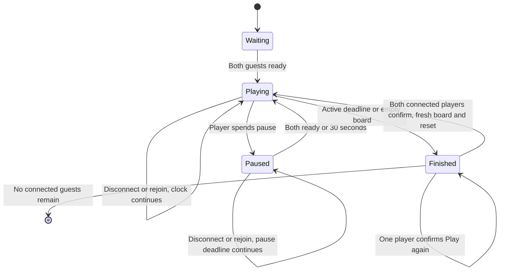

# Playable shared-board competition

For a server you can see and stop in Docker Desktop, follow [local Docker setup](local-docker.md). The native Node commands below remain available.

This extends [private rooms](versus-rooms.md) with a browser match. Run `npm ci`, `npm run build`, then `npm start`, and open http://127.0.0.1:2567 in two browser sessions. Create a room with a nickname and share its link/code. **Copy room code** copies only the code; **Copy invite link** copies the URL. Clipboard writes are attempted first; HTTP/permission fallback exposes selected text and attempts legacy copying. If copying is unavailable, follow the manual-copy guidance. A success message is shown only after a copy operation succeeds. Both guests choose **I'm ready** to start. At finish, choose **Play again**; both players confirm to start another round in the same room. **New game** leaves the room instead. Hosting and public HTTPS/WSS remain issue 4/7. Running from the repository root is required because the server serves the browser files from web/ and dist/web/.

## Play

Draw a free rectangle in either direction and release. Only active fruit whose rendered centers are strictly inside it count; the whole fruit need not fit. The drawn box and apple highlights agree, and a nearby badge shows the sum. A tap does not establish a corner; no snapping, alternate selection or touch zoom remains. Pending confirmation keeps the box visible until the server responds. See [mobile interaction](mobile-interaction.md) for input lifecycle/fullscreen details. The same interface is available in [solo play](solo-play.md). The owner reported Android Brave two-player/fullscreen success, while revised physical-device acceptance remains open.

## Authority and recovery

The pure [Match module](../src/match.ts) receives a server-monotonic time and serialized commands; the Colyseus room adapts it to transport. A command includes its round number and an increasing per-player command ID; a clear also includes integer cell rectangle with exclusive bottom/right, and ordered IDs of intended active fruit. The first valid server-arriving command wins. An old selection remains valid if its intended fruit is unchanged. Repeated/out-of-order command IDs are rejected without additional credit. No client timestamp determines priority. Board generation happens before each new round, outside clear processing. First-round commands without a round number remain compatible; later rounds require their explicit number so old messages cannot affect them.

Matches finish at 120 seconds of active play or an empty board; no-moves boards do not end early. Deadline transitions run before processing a command, including delayed timer ticks. Equal final scores are a draw. Either player can spend two pauses, each at most 30 seconds; additional pause requests while paused consume no chance. Pauses hide the board and cancel active/pending selection. The large red **Resume** button is centered on a full-screen pause cover. Both players must choose Resume for early resumption; after one confirms, their button shows waiting feedback. Pause time does not consume active play; excess elapsed time after a delayed pause expiry does.

Dropped connections reserve their seat and preserve score/identity until match finish. The browser SDK retries and a per-tab session-storage token permits refreshing/rejoining. A disconnection never pauses the match, even with both guests away. Server shutdown loses all rooms. Tokens are bearer credentials: do not share them or publish storage captures. The public invite contains only the room ID. Lobby departure releases the seat; active participant voluntary departure is distinct from a recoverable unexpected drop. Finished results remain available while guests are connected; no new rejoin is admitted after finish. Empty finished rooms are disposed. Choose **Play again** to confirm a rematch. Results and the finished board stay visible until both connected players confirm; the server then generates a fresh certified board and resets scores, 120 active seconds, two pauses and readiness. Nicknames, identities and room code remain. The browser saves its rejoin token again when the new round starts. A departed opponent prevents rematching; use New game to invite someone else. [ADR 0005](adr/0005-rematch-in-the-same-room.md) records the accepted consent rule.

[ADR 0004](adr/0004-confirm-clears-and-rejoin.md) records the accepted confirmation/rejoin choices. [Licensing](licensing.md) records source reuse and notice obligations. [Issue 13](https://github.com/matthew-ngzc/fruit-box/issues/13) owns delivery.

## Verification and limitations

Tests use the previously approved pure-rules and real-Colyseus-client interfaces: competing clears, duplicate delivery, stale non-overlapping clears, invalid rectangles, deadlines, empty boards/draws, pause budgets/expiry/early resume, synchronized readiness and actual drop/reconnect preserving identity and score. The browser is manually automated through real pointer inputs and refresh; screenshots/recording are linked in the issue/PR. Desktop/mobile viewport checks are distinct from physical-device acceptance.

The implementation is an initial local playable preview. Hosting, deployment, persistent results, accounts or unprompted automatic restarts are not included. A [solo browser preview](solo-play.md) is now available. Existing pure solo rules remain available. Required actual-phone evidence remains pending in issue 3; keep that limitation visible when reviewing the UI.

## Captured browser evidence

Desktop Chrome at 1000px and mobile viewport at 390×844: real pointer clear and synchronized score, pause hiding on both guests, both-ready resume, refresh/rejoin preserving score, actual 120-second active deadline and winner, plus explicit-invite/new-room navigation. These are browser viewport checks, not physical-phone acceptance.

