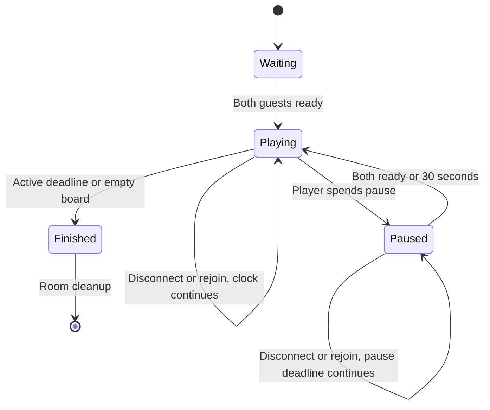
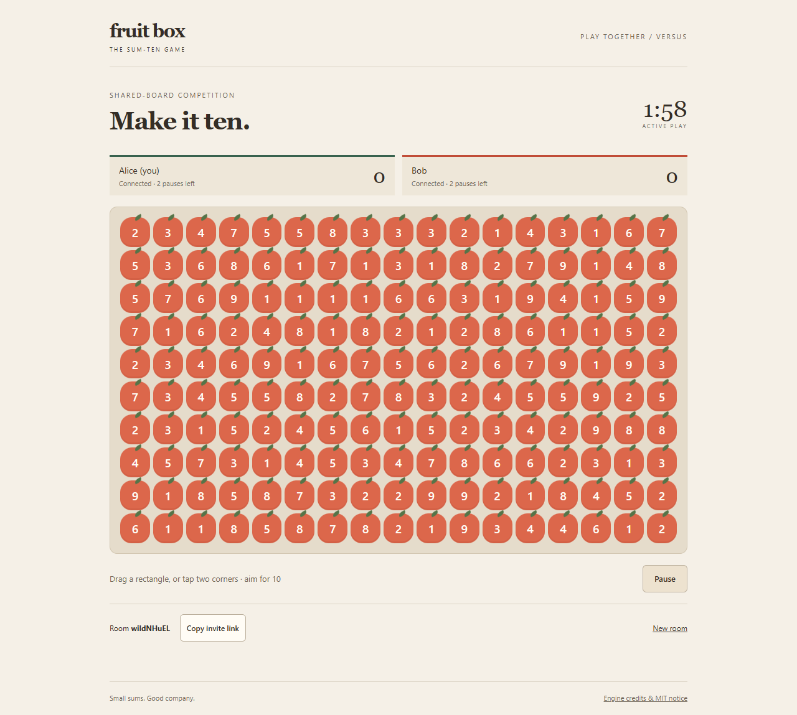
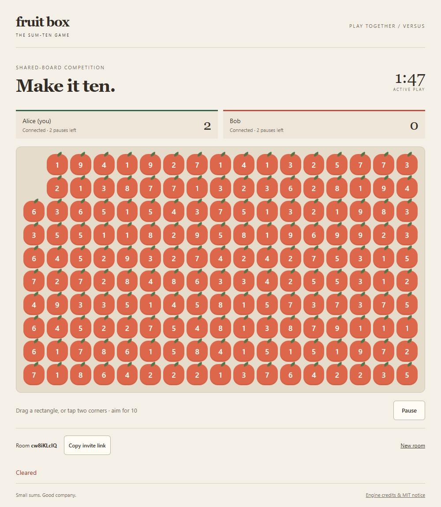
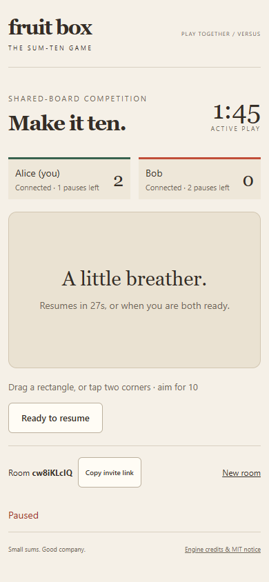
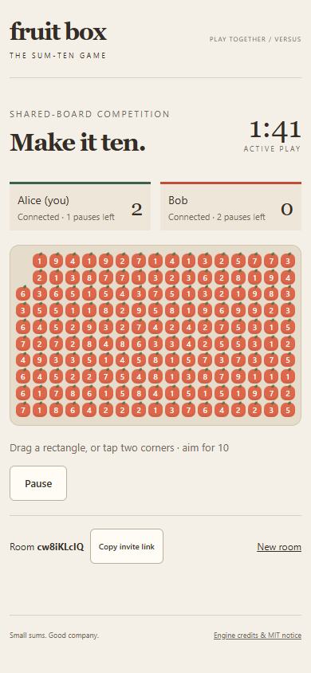
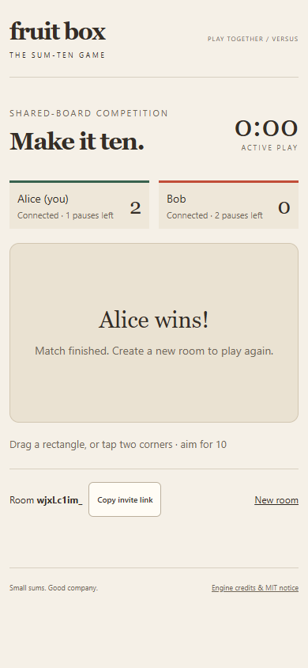

# Playable shared-board competition

For a server you can see and stop in Docker Desktop, follow [local Docker setup](local-docker.md). The native Node commands below remain available.

This extends [private rooms](versus-rooms.md) with a browser match. Run `npm ci`, `npm run build`, then `npm start`, and open http://127.0.0.1:2567 in two browser sessions. Create a room with a nickname and share its link/code. Both guests choose **I'm ready** to start. For another match, create a new room. Hosting and public HTTPS/WSS remain issue 4/7. Running from the repository root is required because the server serves the browser files from web/ and dist/web/.

## Play

Drag a rectangle in either direction, or tap/click two opposite cells; keyboard users can focus and activate the two corners. Remaining fruit must total ten. The pending rectangle stays highlighted until the server confirms or rejects; scores count fruit, not values. Only committed board changes are shared. Nicknames are inserted as text, never HTML. The 17-by-10 portrait board is a first implementation preview; small touch targets and real iPhone/Android usability require issue 3 acceptance. No actual-device touch acceptance is claimed.

## Authority and recovery

The pure [Match module](../src/match.ts) receives a server-monotonic time and serialized commands; the Colyseus room adapts it to transport. A clear includes an increasing per-player command ID, integer cell rectangle with exclusive bottom/right, and ordered IDs of intended active fruit. The first valid server-arriving command wins. An old selection remains valid if its intended fruit is unchanged. Repeated/out-of-order command IDs are rejected without additional credit. No client timestamp determines priority. Board generation happens once before the match, outside move processing.

Matches finish at 120 seconds of active play or an empty board; no-moves boards do not end early. Deadline transitions run before processing a command, including delayed timer ticks. Equal final scores are a draw. Either player can spend two pauses, each at most 30 seconds; additional pause requests while paused consume no chance. Pauses hide the board and cancel active/pending selection. Both ready resumes early. Pause time does not consume active play; excess elapsed time after a delayed pause expiry does.

Dropped connections reserve their seat and preserve score/identity until match finish. The browser SDK retries and a per-tab session-storage token permits refreshing/rejoining. A disconnection never pauses the match, even with both guests away. Server shutdown loses all rooms. Tokens are bearer credentials: do not share them or publish storage captures. The public invite contains only the room ID. Lobby departure releases the seat; active participant voluntary departure is distinct from a recoverable unexpected drop. Finished results stay visible for up to 60 seconds before room disposal; no new rejoin is admitted after finish.

[ADR 0004](adr/0004-confirm-clears-and-rejoin.md) records the accepted confirmation/rejoin choices. [Licensing](licensing.md) records source reuse and notice obligations. [Issue 13](https://github.com/matthew-ngzc/fruit-box/issues/13) owns delivery.

## Verification and limitations

Tests use the previously approved pure-rules and real-Colyseus-client interfaces: competing clears, duplicate delivery, stale non-overlapping clears, invalid rectangles, deadlines, empty boards/draws, pause budgets/expiry/early resume, synchronized readiness and actual drop/reconnect preserving identity and score. The browser is manually automated through real pointer inputs and refresh; screenshots/recording are linked in the issue/PR. Desktop/mobile viewport checks are distinct from physical-device acceptance.

The implementation is an initial local playable preview. Hosting, deployment, persistent results, accounts, automatic rematches and a solo browser mode are not included. Existing pure solo rules remain available. Required actual-phone evidence remains pending in issue 3; keep that limitation visible when reviewing the UI.

## Captured browser evidence

Desktop Chrome at 1000px and mobile viewport at 390×844: real pointer clear and synchronized score, pause hiding on both guests, both-ready resume, refresh/rejoin preserving score, actual 120-second active deadline and winner, plus explicit-invite/new-room navigation. These are browser viewport checks, not physical-phone acceptance.

