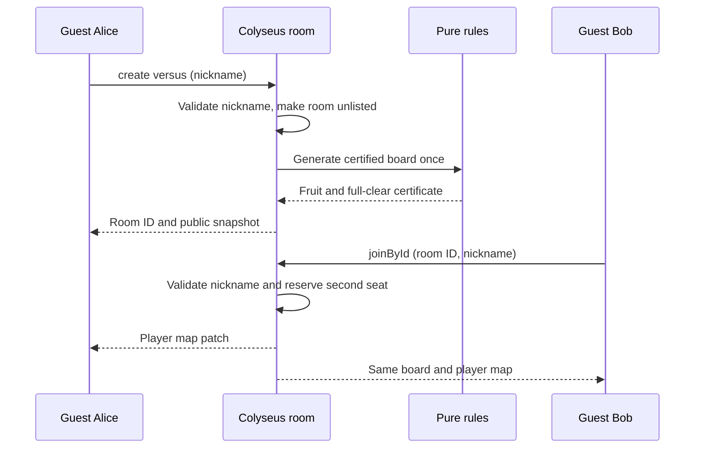

# Private versus rooms

This first implementation slice lets two guest clients create/join an unlisted Colyseus room and receive the same server-owned 17-column, 10-row board. This page describes the room foundation; the [playable match](versus-gameplay.md) extends it. [Issue 11](https://github.com/matthew-ngzc/fruit-box/issues/11) owns this slice; [ADR 0003](adr/0003-typescript-colyseus.md) records the accepted stack.

## Run and demonstrate

Use Node 22.12 or newer and npm. The lockfile pins dependency resolution.

```sh
npm ci
npm test
npm run typecheck
npm run build
npm run demo
npm start
```

`npm run demo` starts a temporary loopback server, connects Alice and Bob through actual HTTP/WebSocket SDK requests, checks both snapshots match and the third guest is rejected, then shuts down. It needs local socket access. `npm start` runs the compiled server on loopback port 2567; `npm run dev` runs the TypeScript source. `PORT` and `HOST` override the binding; public hosting/HTTPS/WSS remain #4/#7. The browser page is now served at the same address; see [gameplay](versus-gameplay.md).

## Client contract

```typescript
import { Client } from '@colyseus/sdk';
const client = new Client('http://127.0.0.1:2567');
const host = await client.create('versus', { nickname: 'Alice' });
const guest = await client.joinById(host.roomId, { nickname: 'Bob' });
// Subscribe to onStateChange; joining can resolve before the first snapshot.
```

Share the room ID privately. Unlisted means excluded from room-name matching; possession of the ID grants access, not authenticated membership. There are two seats. Nicknames are trimmed, 1–24 Unicode code points, no control/format characters, and may duplicate. Colyseus session IDs distinguish connections; they are not durable player identities. Bad admission is rejected before adding a player; failed creation is validated before generating a board.

Public state contains `rows`, `columns`, a row-major `board` of numeric values and a `players` map keyed by session ID. The current board stays unchanged while guests join/leave. Client options cannot supply a board or seed. Certificates and generation details are not synchronized. The later playable match adds commands documented in [gameplay](versus-gameplay.md).



## Ownership and limits

[The pure rules module](../src/rules.ts) exposes certified generation and immutable inspection/clearing, without importing Colyseus. The pinned MIT generator is [vendored with provenance](../vendor/fruit-box-game/README.md). [The room](../src/versus-room.ts) owns the public state and admission. Generation happens synchronously once during room setup; this can delay other room setup on the Node event loop. No latency/load guarantees are claimed. A worker/precomputed board pool belongs before scaling, not inside live clear handling.

Rooms are in memory in one process; shutdown loses them. Leaving releases a seat; an empty room is disposed by Colyseus. This is pre-match behavior only. The [playable extension](versus-gameplay.md) now implements timed matches, clear ordering, duplicate handling, pauses and recovery. Automatic rematches and a solo browser mode remain later work. Phone touch acceptance remains #3.

## Verification

The owner agreed to two public test interfaces: direct rules calls and real SDK clients against a listening server. Tests check certificate replay, clear validity/count/immutability, shared snapshots, duplicate-name identities, malformed nicknames, seat limits/replacement, private matching, client-option resistance and room isolation. They do not access private room internals or mock transport. The console demo is reproducible transport evidence; screenshots and phone recordings are not applicable to this server-only slice.

Authoritative references: [Colyseus rooms](https://docs.colyseus.io/room), [schema definition](https://docs.colyseus.io/state/schema), [server setup](https://docs.colyseus.io/server). Exact installed versions are in package.json and package-lock.json; package types/source were checked alongside current documentation.
